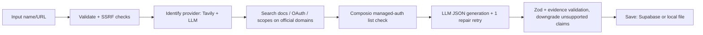

# OAuth Launchpad

Developer-facing OAuth setup guides for Composio APM integrations. It has a curated directory (GitHub, Slack, Google), source-backed guide pages, and a live AI research workflow that generates guides for unfamiliar apps and saves them at shareable URLs.

Guides separate **hands-on time** from **approval wait** and label every claim: `Verified from official documentation`, `Tested directly`, `Estimated`, `Inferred`, `Unknown or needs confirmation`.

## Run locally

```bash
npm install --legacy-peer-deps   # vitest peer-dep conflict with the scaffold
cp .env.example .env.local       # fill in values (see below)
npm run dev                      # http://localhost:3000
```

Example for Google Gemini (any OpenAI-compatible provider works the same way):

```bash
LLM_BASE_URL=https://generativelanguage.googleapis.com/v1beta/openai
LLM_MODEL=gemini-3-flash-preview
```

The model must be available to your key; older Gemini models can return HTTP 404 for new keys.

Without keys the directory and the three curated guides work. Generating a new guide returns an explicit "not configured" error (HTTP 503) and does no research.

## Environment variables

| Variable | Needed for |
|---|---|
| `TAVILY_API_KEY` | Live web search (required for generation) |
| `LLM_API_KEY` (or `OPENAI_API_KEY`) | LLM guide synthesis (required for generation) |
| `LLM_BASE_URL`, `LLM_MODEL` | Optional; any OpenAI-compatible `/chat/completions` with JSON mode (defaults: OpenAI, `gpt-4.1-mini`) |
| `SUPABASE_URL`, `SUPABASE_SERVICE_ROLE_KEY` | Durable persistence. Server-only. Run `supabase/schema.sql` first |
| `GENERATE_RATE_LIMIT`, `SEARCH_TIMEOUT_MS`, `LLM_TIMEOUT_MS` | Optional tuning |

No secret is exposed to the browser; all keys are read in server routes only. If Supabase is not configured, guides are written to `.data/guides.json` (gitignored). On Vercel this falls back to a temp dir and is **not durable**; use Supabase there.

## How generation works



- Progress is streamed as real NDJSON stage events from `/api/generate`.
- Source text comes from Tavily results (raw content or snippets); the server never fetches user-supplied URLs. The only direct fetch is the constant Composio managed-auth page.
- Claims cite source ids. `verified_docs` requires a retrieved official page; `tested` requires a direct request and is **never** assigned to generated guides. Unsupported claims are downgraded to `inferred`. Numeric approval timelines without a cited source are removed.
- Ambiguous or unverifiable apps return candidates/errors rather than a guess.
- Security: input rejects private/local/IP hosts, credentials, non-http(s), markup; per-IP rate limit; React text rendering only (no `dangerouslySetInnerHTML`); external links are checked and use `rel="noopener noreferrer"`.

## Curated guides and evidence

GitHub, Slack and Google guides are `partially_verified`: some official pages were retrieved (excerpts), others were not and their claims are labelled inferred/unknown. Three direct requests with dummy credentials were run against the real token endpoints. The Slack `invalid_code` and Google `invalid_client` results back claims labelled `tested`. The GitHub request returned `{"error":"Not Found"}` without a captured status, so it is cited only on a claim labelled `inferred`. No full OAuth flow was run end to end.

## Tests

```bash
npm run typecheck && npm run lint && npm test && npm run build
```

Last run: `typecheck`, `lint`, `test` (23 unit tests) and `build` all exit 0. Earlier runs also covered (schema/evidence rules, estimates, filters, input safety, rate limit, Composio parsing, source building, local store round trip). Against a running `next start`: pages and guides return 200, unknown/traversal slugs 404, `/api/status` correct, unconfigured generation 503, invalid/private/ftp input 400, rate limit 429, no secret names in client bundles.

## Deploy (Vercel)

Import the repo, set the env vars above, and use Supabase. `vercel.json` sets `maxDuration` 120 for the generate route. The rate limiter is in-memory per instance, so it is a soft limit on serverless.

## Not verified / limitations

- Live generation was run once end to end (`https://linear.app`, Tavily plus Google Gemini `gemini-3-flash-preview` via the OpenAI-compatible endpoint). It completed and saved guide `linear-43987e` to the local file store. Earlier browser attempts showed a "not valid JSON" error that was not reproduced in the final run, so LLM output can still fail intermittently. The browser flow was not re-verified after the fix.
- Supabase persistence is **untested** (no project was configured).
- Not deployed to Vercel and not pushed to GitHub.
- UI was not visually inspected at multiple viewports.
- Doc-domain trust relies on LLM identification cross-checked with search result hosts. Search-provider text may be truncated.
- Components are hand-built Tailwind (shadcn/ui not installed).

## Next steps

More curated apps; retrieve the unfetched official pages for the curated guides; a headless end-to-end OAuth test; auth/quotas and a durable rate limiter; background job queue for generation.
